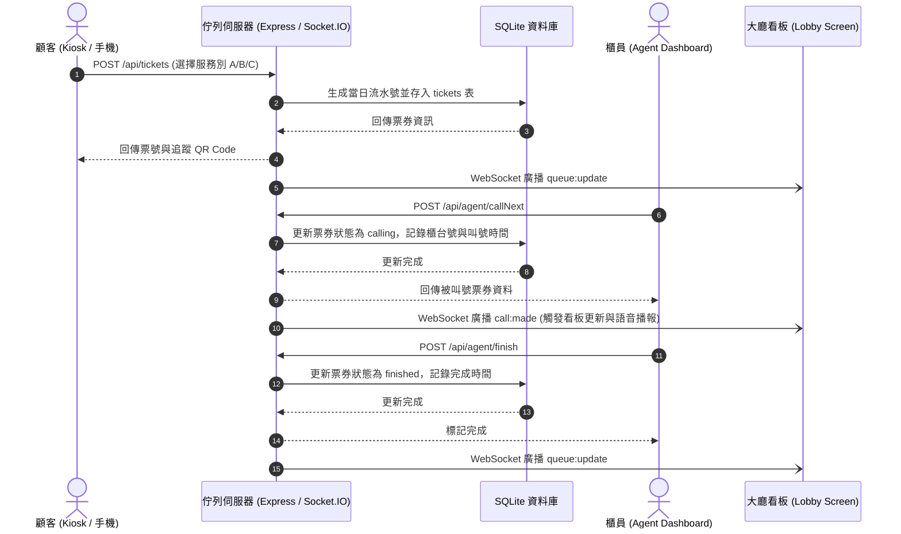
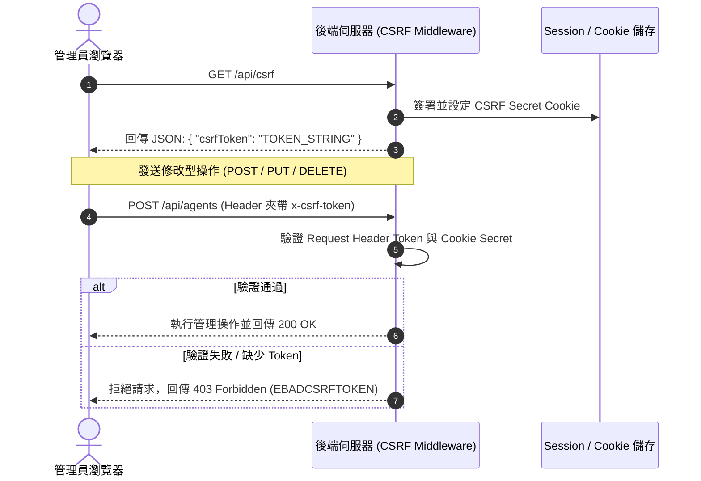

# 數位叫號嵌入式網頁模組 (Digital Queue System)

可嵌入既有企業網站、多功能資訊站（Kiosk）的排隊取號、櫃員叫號管理、大廳多媒體動態看板系統。本系統採用輕量高效的架構設計，整合 Express 後端服務、Socket.IO 即時雙向通訊、SQLite 嵌入式資料庫與 QR Code 即時取號及查詢功能。

---

## 目錄

- [專案簡介與系統特色](#專案簡介與系統特色)
- [系統架構與流程圖](#系統架構與流程圖)
- [快速開始](#快速開始)
- [環境配置說明 (.env)](#環境配置說明-env)
- [專案目錄結構](#專案目錄結構)
- [管理與帳號安全 (CSRF 防護)](#管理與帳號安全-csrf-防護)
- [REST API 規格文件](#rest-api-規格文件)
- [WebSocket 即時通訊事件](#websocket-即時通訊事件)
- [資料庫結構 (SQLite Schema)](#資料庫結構-sqlite-schema)
- [生產環境安全與部署建議](#生產環境安全與部署建議)
- [常見問題與疑難排解 (Troubleshooting)](#常見問題與疑難排解-troubleshooting)
- [版本更新紀錄 (Changelog)](#版本更新紀錄-changelog)
- [專案聯繫資訊](#專案聯繫資訊)
- [授權條款](#授權條款)

---

## 專案簡介與系統特色

本系統模組化設計完備，提供完整的排隊叫號全流程解決方案：

- **客戶端取號小工具 (Kiosk / Widget)**：提供訪客觸控取號介面，支援 iframe 嵌入既有網站，並能動態生成票券 QR Code 供行動裝置掃描追蹤。
- **櫃員端操作介面 (Agent Dashboard)**：具備櫃台登入認證、順序叫號、特定叫號、重新呼叫、標記服務中、完成服務、取消票券、櫃台與業務轉移等完整業務操作。
- **大廳顯示看板 (Lobby Display)**：支援大螢幕即時動態跳號顯示、多櫃台狀態輪播、歷史叫號紀錄，以及瀏覽器 Web Speech API 語音合成廣播播報。
- **顧客行動進度追蹤 (Mobile Ticket)**：顧客可透過手機掃描票券 QR Code 隨時查看前方等候人數與叫號進度，減少現場群聚。
- **統一認證與圖形驗證碼 (Login & Captcha)**：具備防暴力破解之圖形驗證碼機制（支援 Sharp 高性能點陣圖生成與 SVG 向量圖降級方案）。
- **權限與櫃員管理介面 (Admin Console)**：管理員專屬後台，提供櫃員帳號建立、資料修改、密碼重設、啟用狀態切換與固定櫃台號綁定。
- **企業級安全防護機制 (Enterprise Security)**：全面實作 CSRF Token 驗證、分級速率限制（Rate Limiting）、DOM XSS 安全過濾、CORS 來源校驗與 HTTP 安全標頭（Helmet）。

---

## 系統架構與流程圖

### 1. 排隊叫號業務流程



### 2. CSRF 安全防護流程



---

## 快速開始

### 1. 系統需求

- **執行環境**：Bun (推薦) 或 Node.js 18.0.0 以上
- **作業系統**：Windows / macOS / Linux
- **資料庫**：內建 SQLite 3（無需額外安裝獨立資料庫服務，系統首次啟動時將自動建立 `db/queue.db`）

### 2. 安裝相依套件

請使用 Bun 套件管理工具安裝專案相依模組：

```powershell
bun install
```

### 3. 設定環境變數

複製環境變數範本檔案，並根據您的實際運行環境進行配置：

```powershell
# 複製環境變數範本
Copy-Item .env.example .env

# 編輯 .env 檔案
notepad .env
```

**開發環境範例配置：**
```env
PORT=3000
NODE_ENV=development
SESSION_SECRET=請設定隨機強密碼字串（至少32字元）
SERVICE_TYPES=A,B,C,D,E
# 開發模式下系統會自動允許本機來源 (localhost 與 127.0.0.1)，無需額外設定 ALLOWED_ORIGINS
```

**正式生產環境（或搭配反向代理 / DevTunnel）範例配置：**
```env
PORT=3000
NODE_ENV=production
SESSION_SECRET=請設定隨機強密碼字串（至少32字元）
ALLOWED_ORIGINS=https://queue.yourcompany.com,https://your-tunnel-id.devtunnels.ms
PUBLIC_ORIGIN=https://queue.yourcompany.com
TRUST_PROXY=1
SERVICE_TYPES=A,B,C,D,E
```

### 4. 初始化管理員帳號

由於管理介面具備身分與權限驗證，請依照以下方式在 SQLite 資料庫中建立第一組管理員帳號：

#### 步驟 1：產生密碼之 bcrypt 雜湊值
```powershell
bun -e "console.log(require('bcryptjs').hashSync('您的密碼', 10))"
```

#### 步驟 2：寫入資料庫
確保已啟動過一次服務生成資料庫，或手動建立 `db` 資料夾後執行：
```powershell
sqlite3 db/queue.db
```

在 SQLite 命令介面中執行下列 SQL（將 `<您的-bcrypt-hash>` 替換為步驟 1 的輸出）：
```sql
INSERT INTO agents (account, name, password, counter, role, active, createdAt) 
VALUES ('admin', '系統管理員', '<您的-bcrypt-hash>', '', 'admin', 1, datetime('now'));
.exit
```

### 5. 啟動伺服器

**開發模式（支援檔案變更熱重載）：**
```powershell
bun run dev
```

**生產模式（直接以 Bun / Node 執行）：**
```powershell
bun start
```

### 6. 前端端點訪問一覽

| 模組名稱 | 本地訪問 URL (預設埠 3000) | 說明 |
|----------|-----------------------------|------|
| **客戶端取號介面** | `http://localhost:3000/kiosk/index.html` | 訪客選取服務別取號，支援 iframe 嵌入 |
| **櫃員操作端介面** | `http://localhost:3000/agent/index.html` | 櫃員叫號、過號處理、轉移與服務完成 |
| **大廳叫號顯示看板** | `http://localhost:3000/lobby/index.html` | 現場大螢幕即時顯示各櫃狀態與語音播報 |
| **顧客票券查詢介面** | `http://localhost:3000/ticket/index.html` | 掃描 QR Code 後之手機專屬追蹤頁面 |
| **統一登入頁面** | `http://localhost:3000/login/index.html` | 櫃員與管理員登入（含 Captcha 驗證） |
| **管理員控制台** | `http://localhost:3000/admin/agents.html` | 櫃員帳號增刪改查與櫃台綁定管理 |

> **提示**：若在遠端或透過公開網域訪問，請將上述網址中的 `http://localhost:3000` 替換為 `.env` 中設定的 `PUBLIC_ORIGIN`。

---

## 環境配置說明 (.env)

系統主要透過根目錄下的 `.env` 檔案進行運行時參數配置：

| 變數名稱 | 必要性 | 預設值 | 說明 |
|----------|--------|--------|------|
| `PORT` | 選填 | `3000` | HTTP 伺服器監聽的連接埠。 |
| `NODE_ENV` | 選填 | `development` | 運作環境模式。可設定為 `development` 或 `production`。 |
| `SESSION_SECRET` | 必要 | 無 | Session 加密密鑰。未設定時系統將拒絕啟動（所有環境皆同）。 |
| `ALLOWED_ORIGINS` | 生產環境必要 | 無 | 允許跨來源資源共用 (CORS) 的來源清單。多個來源請以逗號 `,` 分隔，結尾請勿包含斜線 `/`。 |
| `PUBLIC_ORIGIN` | 生產環境必要 | 無 | 外部公開訪問的基礎 URL，系統生成票券 QR Code 與重定向連結時使用。開發環境未設定時由請求的 Host 推導。 |
| `SERVICE_TYPES` | 必要 | 無 | 允許的業務類別代碼（逗號分隔，例如 `A,B,C,D,E`），須與取號機與櫃員介面的服務卡一致。取號、叫號、轉櫃等 API 只接受清單內代碼；未設定時系統將拒絕啟動。 |
| `TRUST_PROXY` | 生產環境必要 | 無（不信任代理） | 反向代理信任設定：代理層數（如單層 Nginx 填 `1`）、直接對外服務填 `false`，或以逗號分隔的代理 IP／網段。只有受信任的代理可設定 `X-Forwarded-*`（影響速率限制的來源 IP 與公開網址推導）。 |

### 智能 CORS 存取控制規則

| 請求來源類型 | 開發模式 (development) | 生產模式 (production) |
|--------------|-----------------------|-----------------------|
| **無 Origin 標頭請求**（如同源頁面、伺服器端腳本、curl） | 允許存取 | 允許存取 |
| **本機同埠來源** (`http://localhost:當前PORT`) | 自動允許 | 自動允許 |
| **本機異埠來源** (`http://localhost:其他PORT`) | 自動允許 | 拒絕存取（記錄安全日誌） |
| **符合 ALLOWED_ORIGINS 白名單之網域** | 允許存取 | 允許存取 |
| **非白名單之外部網域** | 拒絕存取 | 拒絕存取（記錄安全日誌） |

---

## 專案目錄結構

```
CNS/
├── server.js                 # 主伺服器入口（Express、Socket.IO、CORS、Rate Limiting、CSRF、API 路由）
├── package.json              # 專案套件配置、相依性與指令腳本
├── .env.example              # 環境變數設定範本
├── .gitignore                # Git 版本控制忽略清單（已排除 .env 與 SQLite 資料庫）
├── db/                       # 資料庫儲存目錄
│   └── queue.db              # SQLite 嵌入式資料庫（啟動時自動建立）
└── public/                   # 前端純靜態資源目錄
    ├── admin/                # 管理員控制台
    │   └── agents.html       # 櫃員帳號維護與櫃台綁定頁面
    ├── agent/                # 櫃員端操作介面
    │   ├── index.html        # 櫃員叫號工作台
    │   ├── agent.css         # 櫃員工作台樣式
    │   └── agent.js          # 櫃員工作台互動與 WebSocket 邏輯
    ├── kiosk/                # 取號端介面
    │   ├── index.html        # 觸控取號小工具
    │   ├── kiosk.css         # 取號介面樣式
    │   └── kiosk.js          # 取號與票券列印/QR Code 生成邏輯
    ├── lobby/                # 大廳看板介面
    │   ├── index.html        # 大螢幕跳號看板
    │   ├── lobby.css         # 看板視覺樣式
    │   └── lobby.js          # 即時跳號動畫與語音播報邏輯
    ├── login/                # 統一登入模組
    │   ├── index.html        # 登入頁面（含 Captcha 驗證碼元件）
    │   └── login.js          # 登入認證請求與錯誤處理
    ├── ticket/               # 顧客端行動追蹤模組
    │   ├── index.html        # 票券進度即時查詢頁面
    │   └── ticket.js         # 票券狀態輪詢與 DOM 安全渲染
    └── utils/                # 前端共用核心工具庫
        ├── auth-checker.js   # 登入狀態校驗與跳轉守衛
        ├── input-validator.js# 前端輸入清理、防 XSS 與資料格式驗證
        └── url-manager.js    # 安全 URL 跳轉白名單與 Protocol 檢驗
```

---

## 管理與帳號安全 (CSRF 防護)

為防止跨站請求偽造（CSRF）攻擊，本系統對涉及狀態變更的敏感 API（如建立櫃員、修改帳號、刪除櫃員等）實作了嚴格的 CSRF Token 驗證機制：

1. **獲取 Token**：登入後，客戶端在發送非安全 HTTP 方法（`POST`、`PUT`、`DELETE`）前，需先發送 `GET /api/csrf` 請求。Token 綁定於伺服器端 Session，並於 Response Body 回傳 `{ "csrfToken": "..." }`。
2. **夾帶標頭**：後續發送修改請求時，必須在 HTTP Request Header 中夾帶 `x-csrf-token: <csrfToken>`。
3. **豁免端點**：僅 `POST /api/login`、`POST /api/tickets`（匿名取號）與驗證碼端點不需 Token；其餘狀態變更請求一律驗證。

### 櫃台號（Counter）綁定規則

- 櫃台號由管理員在後台（`/admin/agents.html`）建立或編輯櫃員時指定。
- 櫃員登入系統後，系統將自動載入其所屬的櫃台號碼。
- 櫃員操作介面上的櫃台號欄位為**唯讀 (Read-only)**，防止櫃員誤改或冒用他人櫃台叫號。

---

## REST API 規格文件

### 1. 公共端點 (Public Endpoints)

| 方法 | 路徑 | 參數說明 | 描述 |
|------|------|----------|------|
| `GET` | `/api/health` | 無 | 伺服器健康狀態檢查。 |
| `POST` | `/api/tickets` | Body: `{ "serviceType": "A" }` | 訪客取號，建立新排隊票券。 |
| `GET` | `/api/tickets/waiting` | Query: `?serviceType=A`（選填） | 取得指定業務類別之目前等待清單；省略時回傳所有已設定類別。 |
| `GET` | `/api/ticket/:id` | Path: `id` (票券 ID) | 查詢指定單筆票券目前狀態與進度。 |
| `GET` | `/api/overview` | 無 | 取得全系統叫號現況、各櫃台狀態與等候人數。 |
| `GET` | `/api/qrcode` | Query: `?text=https://...` | 生成指定文字之 PNG 格式二維碼圖片。 |

### 2. 認證與驗證碼 (Auth & Captcha)

| 方法 | 路徑 | 參數說明 | 描述 |
|------|------|----------|------|
| `GET` | `/api/captcha/new` | 無 | 建立一組 Captcha 驗證 Token（回傳 `{ token, expiresAt }`）。 |
| `GET` | `/api/captcha/image/:token` | Path: `token` | 取得對應 Token 之圖形驗證碼圖片（優先回傳 PNG，降級回傳 SVG）。 |
| `POST` | `/api/login` | Body: `{ "account", "password", "captchaToken", "captchaText" }` | 櫃員/管理員登入並建立 Session。 |
| `POST` | `/api/logout` | 無 | 登出並銷毀當前 Session。 |
| `GET` | `/api/me` | 無 | 取得目前登入使用者的身分與櫃台綁定資訊。 |
| `GET` | `/api/csrf` | 無 | 取得 CSRF 防護 Token（回傳 `{ csrfToken }`）。 |

### 3. 櫃員操作端點 (Agent Operations - 需登入 Session)

| 方法 | 路徑 | 參數說明 | 描述 |
|------|------|----------|------|
| `POST` | `/api/agent/callNext` | Body: `{ "serviceType": "A" }` | 呼叫指定業務別之下一位等候顧客（櫃台號取自登入帳號）。 |
| `POST` | `/api/agent/callSpecific` | Body: `{ "ticketId": 10 }` | 指定叫號（支援指定特定票券；櫃台號取自登入帳號）。 |
| `POST` | `/api/agent/markServing` | Body: `{ "ticketId": 10 }` | 將票券狀態標記為「服務中 (serving)」。 |
| `POST` | `/api/agent/finish` | Body: `{ "ticketId": 10, "result": "處理完成" }` | 標記票券服務結束 (finished)。 |
| `POST` | `/api/agent/recall` | Body: `{ "ticketId": 10 }` | 重新廣播呼叫當前票券。 |
| `POST` | `/api/agent/cancel` | Body: `{ "ticketId": 10, "reason": "過號未到" }` | 取消票券 (cancelled)。 |
| `POST` | `/api/agent/transfer` | Body: `{ "ticketId", "toServiceType", "toCounter" }` | 票券轉櫃或轉換業務服務別。 |
| `POST` | `/api/agent/createTicket` | Body: `{ "serviceType": "A" }` | 櫃員代客取號。 |
| `GET` | `/api/agent/history` | Query: `?serviceType=A&limit=50` | 查詢已完成或歷史叫號明細。 |
| `GET` | `/api/agent/ticket/:id` | Path: `id` | 查詢單筆票券之內部完整詳細欄位。 |

> 票券狀態由伺服器把關：`markServing`／`finish` 只接受已叫號或服務中的票券；已完成（finished）或已取消（canceled）的票券不可再被叫號、服務、結束、取消或轉櫃，違規請求回傳 `409`。

### 4. 管理員端點 (Admin Operations - 需 Admin 權限與 CSRF Token)

| 方法 | 路徑 | 參數說明 | 描述 |
|------|------|----------|------|
| `GET` | `/api/agents` | 無 | 取得所有櫃員與管理員帳號清單。 |
| `GET` | `/api/agents/:id` | Path: `id` | 查詢單一櫃員帳號詳細資料。 |
| `POST` | `/api/agents` | Body: `{ "account", "name", "password", "counter", "role", "active" }` | 建立新櫃員帳號。 |
| `PUT` | `/api/agents/:id` | Body: `{ "name", "counter", "role", "active", "password"(選填) }` | 更新指定櫃員帳號設定。 |
| `DELETE` | `/api/agents/:id` | Path: `id` | 刪除指定櫃員帳號。 |

---

## WebSocket 即時通訊事件

本系統整合 Socket.IO 提供毫秒級的狀態同步廣播：

| 事件名稱 | 方向 | 載荷格式 (Payload) | 觸發時機與用途 |
|----------|------|--------------------|----------------|
| `queue:update` | 伺服器廣播至客戶端 | `{ "serviceType": "A", "overview": { ... } }` | 當有新取號、完成服務、取消票券時觸發，大廳看板與 Kiosk 即時更新等候人數。 |
| `call:made` | 伺服器廣播至客戶端 | `{ "ticket": { "id": 1, "number": "A001", "counter": "2", "calledAt": "..." } }` | 櫃員執行叫號或重新叫號時廣播，大廳看板接收後切換跳號顯示並觸發語音廣播。 |
| `agent:message` | 伺服器廣播至櫃員端 | `{ "type": "info", "message": "系統通告內容" }` | 系統管理員或背景服務發送給全體在線櫃員之即時訊息。 |

---

## 資料庫結構 (SQLite Schema)

系統採用 SQLite 嵌入式資料庫，儲存於 `db/queue.db` 檔案中，主要包含三張核心資料表：

### 1. `seq` 表（每日業務流水號管理）

| 欄位名稱 | 型態 | 條件約束 | 說明 |
|----------|------|----------|------|
| `serviceType` | TEXT | PRIMARY KEY (聯合主鍵) | 業務類別代碼（例如：A、B、C）。 |
| `ymd` | TEXT | PRIMARY KEY (聯合主鍵) | 日期字串，格式為 `YYYYMMDD`。 |
| `seq` | INTEGER | NOT NULL, DEFAULT 0 | 該服務別在該日期之當前最大發放號碼流水號。 |

### 2. `tickets` 表（排隊票券資料）

| 欄位名稱 | 型態 | 條件約束 | 說明 |
|----------|------|----------|------|
| `id` | INTEGER | PRIMARY KEY AUTOINCREMENT | 票券唯一系統序號。 |
| `serviceType` | TEXT | NOT NULL | 服務類別（如 A、B、C）。 |
| `number` | TEXT | NOT NULL | 完整票號字串（例如：`A001`、`B012`）。 |
| `status` | TEXT | NOT NULL, DEFAULT 'waiting' | 票券狀態：`waiting` (等待中)、`calling` (叫號中)、`serving` (服務中)、`finished` (已完成)、`cancelled` (已取消)。 |
| `counter` | TEXT | NULLABLE | 當前受理服務之櫃台編號。 |
| `result` | TEXT | NULLABLE | 服務結果說明或取消原因備註。 |
| `createdAt` | TEXT | NOT NULL | 取號建立時間（ISO 8601 / SQLite datetime）。 |
| `calledAt` | TEXT | NULLABLE | 首次或最近叫號時間。 |
| `finishedAt` | TEXT | NULLABLE | 完成服務或取消時間。 |

### 3. `agents` 表（櫃員與管理員帳號資料）

| 欄位名稱 | 型態 | 條件約束 | 說明 |
|----------|------|----------|------|
| `id` | INTEGER | PRIMARY KEY AUTOINCREMENT | 使用者識別 ID。 |
| `account` | TEXT | UNIQUE, NOT NULL | 登入帳號名稱。 |
| `name` | TEXT | NOT NULL | 櫃員或管理員真實姓名/顯示名稱。 |
| `password` | TEXT | NOT NULL | 經 bcrypt 加密演算法計算後之密碼雜湊值。 |
| `counter` | TEXT | NULLABLE | 預設綁定之櫃台編號（例如：`1`、`2`）。 |
| `role` | TEXT | NOT NULL, DEFAULT 'agent' | 權限角色：`admin` (管理員)、`agent` (一般櫃員)。 |
| `active` | INTEGER | NOT NULL, DEFAULT 1 | 啟用狀態：`1` (正常啟用)、`0` (停用凍結)。 |
| `createdAt` | TEXT | NOT NULL | 帳號建立時間。 |
| `updatedAt` | TEXT | NULLABLE | 帳號最後更新時間。 |

---

## 生產環境安全與部署建議

### 1. 部署前安全檢查清單

- **環境模式**：確保 `.env` 中的 `NODE_ENV` 已設定為 `production`。
- **金鑰安全**：確保 `SESSION_SECRET` 已替換為隨機高強度字串（嚴禁保留預設範例值）。
- **CORS 來源**：確保 `ALLOWED_ORIGINS` 僅包含受信任的正式 HTTPS 網域，不得在生產環境啟用通配或未限制的本機來源。
- **公開位址**：確認 `PUBLIC_ORIGIN` 已正確配置為外部訪問的完整網址（含 `https://`）。
- **檔案權限**：將 `db/queue.db` 檔案權限設定為僅服務執行帳號具備讀寫權限（Linux 建議 `chmod 600 db/queue.db`）。
- **版本控制保護**：確認 `.env` 與 `db/` 目錄已確實加入 `.gitignore`，避免機密外洩。

### 2. Nginx 反向代理配置範例 (SSL/TLS + WebSocket)

```nginx
# HTTP 自動導向至 HTTPS
server {
    listen 80;
    server_name queue.yourcompany.com;
    return 301 https://$server_name$request_uri;
}

# HTTPS 正式服務配置
server {
    listen 443 ssl http2;
    server_name queue.yourcompany.com;

    ssl_certificate /etc/letsencrypt/live/queue.yourcompany.com/fullchain.pem;
    ssl_certificate_key /etc/letsencrypt/live/queue.yourcompany.com/privkey.pem;
    ssl_protocols TLSv1.2 TLSv1.3;
    ssl_ciphers HIGH:!aNULL:!MD5;

    location / {
        proxy_pass http://127.0.0.1:3000;
        proxy_http_version 1.1;
        
        # 支援 WebSocket 升級連線
        proxy_set_header Upgrade $http_upgrade;
        proxy_set_header Connection "upgrade";
        proxy_set_header Host $host;
        proxy_cache_bypass $http_upgrade;
        
        # 傳遞客戶端真實 IP 與安全協議
        proxy_set_header X-Real-IP $remote_addr;
        proxy_set_header X-Forwarded-For $proxy_add_x_forwarded_for;
        proxy_set_header X-Forwarded-Proto $scheme;
    }
}
```

### 3. 使用 PM2 程序管理員穩定守護

```powershell
# 全域安裝 PM2
bun install -g pm2

# 啟動服務並指定程序名稱
pm2 start server.js --name "digital-queue-system"

# 儲存當前程序清單並設定開機自啟
pm2 save
pm2 startup

# 查看即時監控狀態與日誌
pm2 status
pm2 logs digital-queue-system
```

---

## 常見問題與疑難排解 (Troubleshooting)

### 1. 埠號佔用錯誤（EADDRINUSE: address already in use）
- **原因**：設定的連接埠（預設 3000）已被其他本機程序佔用。
- **解決方法**：
  - 指定其他連接埠啟動：
    ```powershell
    $env:PORT='3001'; bun run dev
    ```
  - 或於 Windows PowerShell 查詢並終止佔用該埠之程序：
    ```powershell
    Get-NetTCPConnection -LocalPort 3000 | Select-Object -ExpandProperty OwningProcess | ForEach-Object { Stop-Process -Id $_ -Force }
    ```

### 2. 資料庫鎖定錯誤（database is locked / SQLITE_BUSY）
- **原因**：多個程序同時開啟 SQLite 資料庫檔案進行寫入，或有 GUI 檢視軟體佔用鎖定。
- **解決方法**：關閉所有第三方 SQLite 視覺化工具，終止重複運行的 background node/bun 程序。如仍無法釋放，備份資料庫後刪除 `db/` 目錄下的 `.db-wal` 與 `.db-shm` 暫存檔。

### 3. 跨域存取拒絕（CORS Origin Denied）
- **原因**：前端發出請求之網域未包含於 `.env` 的 `ALLOWED_ORIGINS` 白名單內。
- **解決方法**：檢查 `.env` 設定，將前端來源網址（例如 `https://kiosk.yourcompany.com`）加入 `ALLOWED_ORIGINS`，多個網域以逗號分隔且不要包含多餘空格。開發模式下 localhost 會自動放行。

### 4. 管理 API 報告 CSRF 錯誤（EBADCSRFTOKEN / invalid csrf token）
- **原因**：發送 `POST` / `PUT` / `DELETE` 請求至管理員 API 時，未在 Request Header 中提供有效的 `x-csrf-token`。
- **解決方法**：請先呼叫 `GET /api/csrf` 取得 Token，並在發送管理變更請求時將其夾帶於 `x-csrf-token` 標頭中。

---

## 版本更新紀錄 (Changelog)

### [1.2.0] - 2025-11-27
- **安全性加固**：
  - 實作完整 CSRF Token 驗證機制，全面保護管理與變更 API。
  - 導入分級速率限制（Rate Limiting），防止 DoS 攻擊與惡意濫用。
  - 重構前端 DOM 渲染邏輯，移除 `innerHTML` 拼接，全面改採安全 DOM API 與 `textContent` 防範 XSS 攻擊。
  - 修補 Transitive Dependency 漏洞，將 `cookie` 套件強制升級至安全版本 `0.7.0`。
  - 新增 `public/utils/url-manager.js` 白名單與協議校驗機制，杜絕未授權跳轉。

### [1.1.0] - 2025-10-01
- **功能擴充與環境檢驗**：
  - 實作智能 CORS 機制，開發環境自動識別並支援 localhost 與 DevTunnel。
  - 新增生產環境啟動配置自檢機制，防範遺漏安全參數。
  - 統一伺服器端錯誤處理格式，在生產環境中遮蔽詳細 Stack Trace 資訊避免資訊洩漏。
  - 模組化前端輸入驗證工具庫（`input-validator.js`）。

### [1.0.0] - 2025-08-15
- **初始版本發布**：
  - 核心排隊取號、叫號、重叫、過號與完成服務生命週期。
  - 支援 WebSocket (Socket.IO) 即時雙向大廳看板同步。
  - 整合 SQLite 輕量資料庫與自動初始化。
  - 提供 Captcha 圖形驗證碼與動態 QR Code 生成支援。

---

## 授權條款

本專案採用專有授權。未經許可，禁止公開傳播或未授權之商業部署。