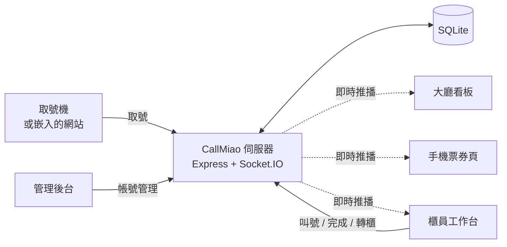

<div align="center">

# 叫號喵 CallMiao

**可嵌入任何網站的排隊取號與叫號系統**

取號機、櫃員叫號台、大廳看板、手機進度追蹤與管理後台，一個伺服器就能全部跑起來。

[](CHANGELOG.md)
[](LICENSE)
[](https://bun.sh)
[](https://nodejs.org)
[](https://socket.io)
[](https://www.sqlite.org)

[快速開始](#快速開始) · [設定](docs/configuration.md) · [API](docs/api.md) · [架構](docs/architecture.md) · [部署](docs/deployment.md) · [安全性](SECURITY.md) · [更新紀錄](CHANGELOG.md)

</div>

---

## 功能特色

| 模組 | 給誰用 | 做什麼 |
|------|--------|--------|
| **取號機** `/kiosk/` | 現場顧客 | 依服務別取號，畫面顯示票號與 QR Code；可用 iframe 嵌入其他網站 |
| **櫃員工作台** `/agent/` | 櫃員 | 依序叫號、指定叫號、重叫、標記服務中、完成、取消、轉櫃、代客取號、查歷史、傳訊息 |
| **大廳看板** `/lobby/` | 等候區大螢幕 | 即時顯示目前叫號與櫃台，並用瀏覽器語音播報 |
| **手機票券頁** `/ticket/` | 掃 QR Code 的顧客 | 查看目前叫號、前面還有幾位；輪到自己時震動並發出提示音 |
| **管理後台** `/admin/` | 管理員 | 建立、編輯、停用、刪除櫃員帳號，指定每位櫃員的櫃台號 |
| **安全防護** | 全系統 | CSRF Token、來源白名單、速率限制、取號上限、圖形驗證碼、CSP 與 Session 撤銷 |

所有畫面透過 Socket.IO 即時同步：櫃員一叫號，看板、取號機與手機票券頁同時更新。

## 運作方式



## 快速開始

### 需求

- [Bun](https://bun.sh)（推薦），或 [Node.js](https://nodejs.org) 22 以上
- Windows、macOS 或 Linux；資料庫用內建的 SQLite，不需要另外安裝

> [!NOTE]
> 專案的指令都直接用 Bun 執行，資料庫使用 Bun 內建的 `bun:sqlite`。改用 Node.js 時，請用 `npm install` 安裝，再執行 `node server.js`（開發時用 `node --watch server.js`），資料庫會自動改用選用相依 `better-sqlite3`。

### 1. 安裝相依套件

```bash
bun install
```

### 2. 建立 `.env`

```bash
cp .env.example .env
```

Windows PowerShell 請改用 `Copy-Item .env.example .env`。下面是可以直接啟動的開發用設定，各欄位的說明請看[環境變數設定](docs/configuration.md)：

```env
NODE_ENV=development
TZ=Asia/Taipei
SESSION_SECRET=請換成-32-字元以上的隨機字串
DB_DIR=db

SERVICE_TYPES=A,B
SERVICE_NAME_A=一般服務
SERVICE_DESC_A=申請、異動與諮詢
SERVICE_NAME_B=繳費服務
SERVICE_DESC_B=繳費與還款

MAX_WAITING_PER_SERVICE=200
MAX_WAITING_PER_CLIENT=3
KIOSK_IPS=
```

> [!IMPORTANT]
> 必填的變數只要缺一個，伺服器就會拒絕啟動，並在終端機列出缺少哪些變數。

### 3. 啟動一次，建立資料庫

```bash
bun run dev
```

第一次啟動會在 `DB_DIR` 底下建立 `queue.db` 與 `sessions.db`。看到 `Server running on http://localhost:3000` 後按 `Ctrl+C` 停止。

### 4. 建立第一個管理員帳號

在專案根目錄執行，最後兩個參數依序是帳號與密碼。Bun 會自動讀取 `.env` 裡的 `DB_DIR`：

```bash
bun -e "const { Database } = require('bun:sqlite'); const bcrypt = require('bcryptjs'); const [account, password] = process.argv.slice(-2); const db = new Database(require('path').resolve(process.env.DB_DIR, 'queue.db')); db.run('INSERT INTO agents (account, password, role, createdAt) VALUES (?, ?, ?, ?)', [account, bcrypt.hashSync(password, 10), 'admin', new Date().toISOString()]); console.log('admin created:', account);" admin "你的密碼"
```

之後的櫃員帳號都可以登入管理後台建立。如果出現 `UNIQUE constraint failed: agents.account`，代表帳號已經存在，請改用[重設密碼](docs/deployment.md#重設密碼)的指令。

### 5. 開始使用

```bash
bun run dev
```

| 頁面 | 網址 |
|------|------|
| 取號機 | <http://localhost:3000/kiosk/index.html> |
| 大廳看板 | <http://localhost:3000/lobby/index.html> |
| 登入（櫃員／管理員） | <http://localhost:3000/login/index.html> |
| 櫃員工作台 | <http://localhost:3000/agent/index.html> |
| 管理後台 | <http://localhost:3000/admin/agents.html> |
| 手機票券頁 | `http://localhost:3000/ticket/index.html?id=<票券 ID>`（由 QR Code 開啟） |

> [!TIP]
> 大廳看板要先按一次畫面上的「啟用聲音」，瀏覽器才允許語音播報。

## 嵌入到你的網站

先把你的網站來源加進 `.env` 的 `ALLOWED_ORIGINS`，再在網頁裡放：

```html
<div id="queue"></div>
<script src="https://queue.example.com/kiosk/widget.js"></script>
<script>
  initQueueWidget({ target: '#queue', height: '520px' });
</script>
```

| 參數 | 說明 | 未指定時 |
|------|------|----------|
| `target` | 放取號頁的元素，可傳選擇器字串或 DOM 元素 | `document.body` |
| `width` | iframe 寬度 | `100%` |
| `height` | iframe 高度 | `520px` |

只有 `/kiosk/` 底下的頁面允許被 `ALLOWED_ORIGINS` 內的網站嵌入，其他頁面一律只能同源嵌入。

## 常用指令

| 指令 | 用途 |
|------|------|
| `bun run dev` | 開發模式，用 Bun 內建的 `--watch`，伺服器程式變更時自動重啟 |
| `bun run dev --host` | 開發模式，並監聽所有網路介面 |
| `bun start` | 正式啟動，只監聽 `localhost` |
| `bun start --host` | 監聽所有網路介面，區網裡的其他裝置也能連線 |
| `bun test` | 整合測試，使用暫存資料庫，不會動到 `DB_DIR` |
| `bun audit` | 檢查相依套件的已知漏洞 |

## 文件導覽

| 文件 | 內容 |
|------|------|
| [環境變數設定](docs/configuration.md) | 每個變數的用途、取號上限怎麼設、來源白名單規則 |
| [API 參考](docs/api.md) | REST API、WebSocket 事件、錯誤碼與速率限制 |
| [系統架構](docs/architecture.md) | 元件關係、叫號流程、票券狀態、資料庫結構、目錄說明 |
| [部署指南](docs/deployment.md) | 上線檢查、Nginx、PM2 與疑難排解 |
| [貢獻指南](CONTRIBUTING.md) | 開發環境、規範與 Pull Request 流程 |
| [行為準則](CODE_OF_CONDUCT.md) | 社群互動的標準 |
| [無障礙聲明](ACCESSIBILITY.md) | 目前支援的項目、已知限制與回報方式 |
| [安全性](SECURITY.md) | 防護機制與漏洞回報方式 |
| [更新紀錄](CHANGELOG.md) | 各版本的變更與升級須知 |

## 技術組成

| 層 | 使用 |
|----|------|
| 伺服器 | Express 5、Socket.IO 4、express-session |
| 資料庫 | SQLite（Bun 用 `bun:sqlite`，Node.js 用 `better-sqlite3`） |
| 安全 | Helmet、express-rate-limit、bcryptjs、svg-captcha |
| 其他 | qrcode（票券 QR Code）、sharp（驗證碼轉 PNG） |
| 前端 | 原生 HTML／CSS／JavaScript，不需要建置步驟 |

## 授權

本專案採用 [MIT License](LICENSE)。
