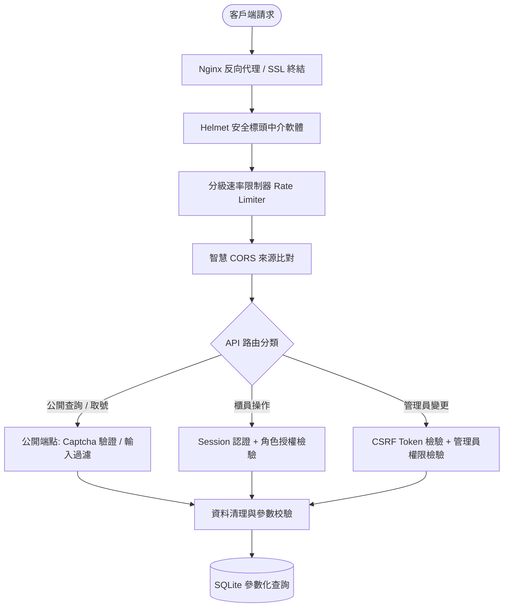

# 系統安全性更新與防護規格說明 (Security Advisory & Hardening Guide)

本文件詳細記錄數位叫號系統之安全性架構、防護機制、安全改進歷史以及生產環境安全維運守則。

---

## 目錄

- [安全性概覽與防護矩陣](#安全性概覽與防護矩陣)
- [縱深防禦架構圖](#縱深防禦架構圖)
- [主要安全防護機制](#主要安全防護機制)
  - [1. 跨站請求偽造防護 (CSRF Protection)](#1-跨站請求偽造防護-csrf-protection)
  - [2. 速率限制與阻斷服務防護 (Rate Limiting)](#2-速率限制與阻斷服務防護-rate-limiting)
  - [3. 跨站腳本攻擊防護與 DOM 安全 (XSS & DOM Sanitization)](#3-跨站腳本攻擊防護與-dom-安全-xss--dom-sanitization)
  - [4. 智慧 CORS 來源校驗與安全跳轉 (CORS & URL Safety)](#4-智慧-cors-來源校驗與安全跳轉-cors--url-safety)
  - [5. 相依套件安全性與 Cookie 加固 (Dependency Hardening)](#5-相依套件安全性與-cookie-加固-dependency-hardening)
  - [6. 環境變數驗證與機密資料保護 (Environment Security)](#6-環境變數驗證與機密資料保護-environment-security)
- [安全驗證與測試指南](#安全驗證與測試指南)
- [前端安全工具庫參考](#前端安全工具庫參考)
- [生產環境部署安全檢查清單](#生產環境部署安全檢查清單)
- [安全漏洞通報流程](#安全漏洞通報流程)
- [安全性更新日誌](#安全性更新日誌)
- [相關文件連結](#相關文件連結)

---

## 安全性概覽與防護矩陣

本系統實作多層次縱深防禦機制（Defense in Depth），涵蓋網路傳輸、請求驗證、身分認證、前端渲染與資料庫層面：

| 防護面向 | 防護技術 / 機制 | 實作位置 / 套件 | 防禦威脅 |
|----------|----------------|----------------|----------|
| **請求來源驗證** | CSRF Token 綁定伺服器端 Session（Synchronizer Token） | `server.js`, `express-session` | 跨站請求偽造攻擊 (CSRF) |
| **頻率控制** | 路由分級速率限制 | `express-rate-limit` | 暴力破解、DoS 阻斷服務、惡意洗票 |
| **內容渲染** | DOM API + textContent 構建 | 前端全模組、`input-validator.js` | 儲存型與反射型 XSS 攻擊 |
| **跳轉控制** | 協定校驗與網域白名單過濾 | `public/utils/url-manager.js` | 開放式重定向 (Open Redirect)、DOM XSS |
| **跨域安全** | 智慧 CORS 動態比對 | `cors` | 非法跨域竊取資料、惡意請求 |
| **傳輸與標頭** | 安全 HTTP Header | `helmet` | 點擊劫持 (Clickjacking)、MIME 嗅探 |
| **認證防護** | 圖形驗證碼 + 密碼 bcrypt 雜湊 | `svg-captcha`, `sharp`, `bcryptjs` | 自動化腳本暴破、憑證填充攻擊 |
| **機密安全** | .env 嚴格排除與權限管控 | `.gitignore`, SQLite 權限 | 憑證外洩、原始碼機密暴露 |

---

## 縱深防禦架構圖



---

## 主要安全防護機制

### 1. 跨站請求偽造防護 (CSRF Protection)

- 針對所有敏感的狀態修改操作（`POST`、`PUT`、`DELETE`），後端均強制要求驗證 CSRF Token。
- 登入後，前端透過 `GET /api/csrf` 端點獲取 Token；Token 以 `crypto.randomBytes` 產生並保存於伺服器端 Session，比對時使用 `crypto.timingSafeEqual`。
- 客戶端在發起修改請求時，必須在 HTTP 標頭中夾帶 `x-csrf-token`，否則伺服器將直接拒絕請求並回傳 `403 Forbidden`。
- 採用條件式 CSRF 機制，精確區隔公開 Kiosk 取號端點與內部管理 API。

### 2. 速率限制與阻斷服務防護 (Rate Limiting)

系統依據 API 端點的敏感度與使用情境，實施分級速率限制：

- **取號頻率限制 (`ticketCreationLimiter`)**：限制單一 IP 短時間內的取號次數，防止惡意腳本大量消耗號碼流水號。
- **公開讀取限制 (`publicReadLimiter`)**：限制大廳看板與查詢 API 的請求頻率，降低伺服器負載。
- **管理與認證限制 (`adminAgentLimiter`, `loginLimiter`)**：針對登入與管理端點施加嚴格的嘗試次數限制，防範暴力破解。

### 3. 跨站腳本攻擊防護與 DOM 安全 (XSS & DOM Sanitization)

- **前端渲染安全**：全面重構管理後台（`agents.html`）、櫃員端（`agent.js`）與票券查詢頁（`ticket.js`），移除動態拼接 `innerHTML` 的作法，全面改用原生 `document.createElement()` 與 `element.textContent` 進行節點建構與賦值。
- **輸入清理工具庫 (`input-validator.js`)**：提供字串實體編碼、帳號/姓名白名單字元過濾與長度校驗。

### 4. 智慧 CORS 來源校驗與安全跳轉 (CORS & URL Safety)

- **自動化跨域判斷**：
  - 開發模式（`NODE_ENV=development`）下只自動放行 `http://localhost:PORT`；其他本機連接埠須列入 `ALLOWED_ORIGINS`，因為 session cookie 由同一主機的所有連接埠共用。
  - 生產模式（`NODE_ENV=production`）下嚴格比對 `.env` 中設定之 `ALLOWED_ORIGINS`，拒絕任何非信任來源並記錄審計日誌。
- **URL 跳轉防護 (`url-manager.js`)**：
  - 封鎖 Protocol-relative URL（例如 `//attacker.com`）。
  - 僅允許標準 `http:` 與 `https:` 協定。
  - 針對非同源或非白名單跳轉實施攔截與降級回首頁保護。

### 5. 相依套件安全性與 Cookie 加固 (Dependency Hardening)

- **漏洞修補鎖定**：透過 `package.json` 中的 `overrides` 將傳遞相依套件 `cookie` 強制鎖定在安全版本 `0.7.0`，防範 Cookie 名稱與屬性解析繞過漏洞。
- **Cookie 屬性加固**：Session Cookie 配置 `HttpOnly` 與 `SameSite=Lax`，生產環境另加 `Secure`，降低 Cookie 遭腳本讀取的風險。

### 6. 環境變數驗證與機密資料保護 (Environment Security)

- **啟動前檢查**：伺服器啟動時會主動驗證環境配置；任何環境未設定 `SESSION_SECRET`、`SERVICE_TYPES` 或 `MAX_WAITING_PER_SERVICE`，或生產環境未設定 `ALLOWED_ORIGINS`、`TRUST_PROXY`、`PUBLIC_ORIGIN`，伺服器將立即終止啟動以防暴露於危險中。
- **版本控制隔離**：`.gitignore` 預設排除 `.env`、`*.db`、`*.sqlite` 以及日誌檔案，確保敏感憑證不流入版本控制系統。

---

## 安全驗證與測試指南

在部署或提交變更前，請透過以下流程進行安全性驗證：

### 1. 執行相依套件安全稽核

```powershell
# 檢查套件安全性漏洞
bun pm audit
```

### 2. 本地開發與 CSRF 功能驗證

啟動本地服務：
```powershell
bun run dev
```

測試 CSRF 防護行為（未帶 Token 應回傳 403，帶 Token 應成功）：
```powershell
# 1. 取得 CSRF Token
$response = Invoke-RestMethod -Uri "http://localhost:3000/api/csrf" -SessionVariable session
$token = $response.csrfToken
Write-Host "取得 CSRF Token: $token"

# 2. 攜帶 Token 進行合法請求
Invoke-RestMethod -Uri "http://localhost:3000/api/agents" -Method Get -WebSession $session
```

---

## 前端安全工具庫參考

### `public/utils/input-validator.js`

提供前端介面常用的輸入清理與驗證方法：

```javascript
// 引入方式
<script src="/utils/input-validator.js"></script>

// HTML 實體編碼（防範 XSS）
const safeText = InputValidator.escapeHtml(rawUserInput);

// 帳號格式過濾（僅允許英數字元與常用符號）
const cleanAccount = InputValidator.sanitizeAccount(accountInput);

// 姓名格式過濾
const cleanName = InputValidator.sanitizeName(nameInput);
```

### `public/utils/url-manager.js`

提供安全的 URL 導航與驗證功能：

```javascript
// 引入方式
<script src="/utils/url-manager.js"></script>

// 驗證並安全跳轉
UrlManager.safeRedirect(targetUrl, fallbackUrl);
```

---

## 生產環境部署安全檢查清單

部署至正式環境前，請逐一核對下列項目：

- [ ] **環境模式**：`.env` 中已明確指定 `NODE_ENV=production`。
- [ ] **密鑰更換**：`.env` 中之 `SESSION_SECRET` 已替換為高強度隨機字串（非預設值）。
- [ ] **網域白名單**：`ALLOWED_ORIGINS` 僅列出正式營運之 HTTPS 網域，未包含任何 localhost 或測試來源。
- [ ] **公開基礎 URL**：`PUBLIC_ORIGIN` 已正確配置為正式 HTTPS 網址。
- [ ] **SSL/TLS 憑證**：已於 Nginx / 反向代理層啟用 HTTPS，並停用不安全的 SSL/TLS 舊版本。
- [ ] **資料庫檔案權限**：`db/queue.db` 檔案權限已限制為僅執行服務之系統使用者可存取。
- [ ] **弱密碼盤點**：已重設所有預設管理員與櫃員密碼為符合長度要求的強密碼。
- [ ] **敏感檔案隔離**：確認 `.env` 與 `db/` 目錄未被 Git 追蹤。

---

## 安全漏洞通報流程

若您在系統中發現任何潛在的安全性漏洞，請遵循負責任的漏洞揭露原則：

1. **請勿在公開 Issue 或討論區中回報安全漏洞**。
2. 請直接透過專案聯繫人電子郵件通報，並提供：
   - 漏洞類型與影響範圍評估。
   - 詳細的復現步驟或概念驗證代碼 (PoC)。
   - 建議的修補方案（若有）。
3. 我們將於收到通報後盡速進行評估、修補並發布安全性更新公告。

---

## 安全性更新日誌

### 2025-11-27 (安全性加固更新)
- 導入 CSRF Token 驗證機制，加固所有管理員與櫃員狀態變更端點。
- 新增分級速率限制（Rate Limiting）以減緩 DoS 風險。
- 鎖定 Transitive Dependency `cookie` 版本為 `0.7.0`，修補潛在解析漏洞。
- 重構管理端、櫃員端與票券端 DOM 渲染邏輯，杜絕 `innerHTML` XSS 風險。
- 新增 URL 安全跳轉與協定驗證機制（`url-manager.js`）。

### 2025-10-01 (基礎安全強化)
- 強化 `.gitignore`，確保 `.env` 與資料庫檔案不進入版本庫。
- 新增智慧 CORS 來源校驗與日誌記錄。
- 新增生產環境啟動配置檢查，防止未配置金鑰即上線。
- 統一錯誤處理機制，生產環境遮蔽堆疊資訊。
- 釋出前端輸入驗證工具（`input-validator.js`）。

---

## 相關文件連結

- [README.md](./README.md) - 專案主說明文件與快速開始
- [package.json](./package.json) - 相依套件與版本宣告
