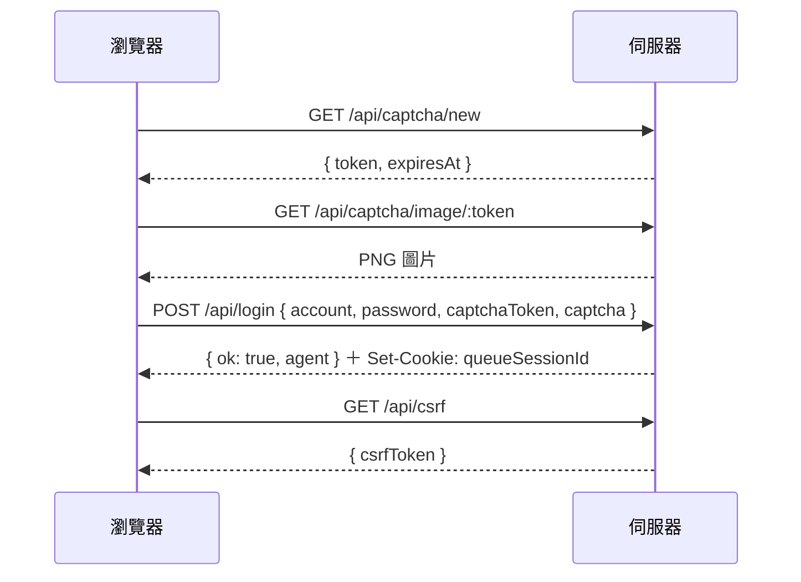

# API 參考

[← 回到 README](../README.md)

叫號喵提供 REST API 與 Socket.IO 即時事件。前端頁面用的就是這些介面，你也可以用它們串接自己的系統。

---

## 目錄

- [共通規則](#共通規則)
- [公開端點](#公開端點)
- [登入與驗證碼](#登入與驗證碼)
- [櫃員端點](#櫃員端點)
- [管理員端點](#管理員端點)
- [WebSocket 事件](#websocket-事件)
- [速率限制](#速率限制)

---

## 共通規則

### 格式

- 請求與回應都是 JSON（QR Code 與驗證碼圖片除外），請求本文上限 100 KB。
- 失敗時一律回 `{ "error": "說明" }`，有些錯誤會附帶額外欄位，例如 `status`、`ticketId`。

### 認證

| 類型 | 怎麼帶 | 適用端點 |
|------|--------|----------|
| 公開 | 不需要 | 取號、查票、總覽、設定、QR Code、驗證碼、登入 |
| 櫃員 | 登入後的 Session Cookie `queueSessionId` | `/api/agent/*`、`/api/csrf`、`/api/logout` |
| 管理員 | Session Cookie，且帳號 `role` 為 `admin` | `/api/agents/*` |

### CSRF Token

除了 `POST /api/login` 與 `POST /api/tickets`，所有 `POST`、`PUT`、`DELETE` 都要在標頭帶 CSRF Token：

```http
GET /api/csrf
→ { "csrfToken": "9f2c…" }

POST /api/agent/callNext
x-csrf-token: 9f2c…
Content-Type: application/json

{ "serviceType": "A" }
```

Token 綁在伺服器端的 Session，登入後取一次即可重複使用；重新登入後要重新取得。

### 狀態碼

| 狀態碼 | 意思 |
|:------:|------|
| `400` | 參數錯誤，例如服務代碼不在 `SERVICE_TYPES`、缺少 `ticketId` |
| `401` | 未登入，或 Session 已被撤銷（改密碼、帳號停用） |
| `403` | 權限不足、CSRF Token 無效、來源不在白名單，或票券屬於其他櫃台 |
| `404` | 票券、帳號不存在，或沒有等候中的票 |
| `409` | 票券狀態不允許這個動作，或櫃台正在服務其他票 |
| `429` | 觸發速率限制或取號上限；速率限制會附 `Retry-After` 標頭 |
| `500` | 伺服器錯誤；正式模式不回傳錯誤細節 |

---

## 公開端點

| 方法 | 路徑 | 說明 |
|------|------|------|
| `GET` | `/api/health` | 健康檢查，回傳 `{ ok: true, time }` |
| `GET` | `/api/config` | 服務別清單 `{ services: [{ code, name, description }] }` |
| `POST` | `/api/tickets` | 匿名取號 |
| `GET` | `/api/ticket/:id` | 查詢單張票券 |
| `GET` | `/api/overview` | 各服務的等候人數、等候順序與目前叫號 |
| `GET` | `/api/qrcode/:ticketId` | 該票券追蹤網址的 QR Code（PNG） |

### `POST /api/tickets`

```json
// 請求
{ "serviceType": "A" }

// 回應 200
{
  "ticket": {
    "id": 42,
    "serviceType": "A",
    "number": "A007",
    "status": "waiting",
    "counter": null,
    "createdAt": "2026-11-15T01:23:45.678Z",
    "calledAt": null,
    "finishedAt": null
  },
  "ticketUrl": "https://queue.example.com/ticket/index.html?id=42"
}
```

| 錯誤 | 原因 |
|------|------|
| `400 invalid serviceType` | 代碼不在 `SERVICE_TYPES` |
| `429 too many waiting tickets from this network` | 超過 `MAX_WAITING_PER_CLIENT` |
| `429 queue is full, please try later` | 超過 `MAX_WAITING_PER_SERVICE` |

### `GET /api/overview`

```json
{
  "summary": [
    { "serviceType": "A", "waiting": 2 },
    { "serviceType": "B", "waiting": 0 }
  ],
  "waiting": {
    "A": [
      { "id": 41, "number": "A006", "createdAt": "…" },
      { "id": 42, "number": "A007", "createdAt": "…" }
    ],
    "B": []
  },
  "currentCalls": [
    { "id": 40, "serviceType": "A", "number": "A005", "status": "called", "counter": "2", "calledAt": "…" }
  ]
}
```

- `waiting` 依取號順序排列，可以直接算出某張票前面還有幾位。
- `currentCalls` 列出已叫號與服務中的票，最新叫號在前，最多 50 筆。

---

## 登入與驗證碼

| 方法 | 路徑 | 認證 | 說明 |
|------|------|------|------|
| `GET` | `/api/captcha/new` | 公開 | 建立驗證碼，回傳 `{ token, expiresAt }`，5 分鐘內有效 |
| `GET` | `/api/captcha/image/:token` | 公開 | 驗證碼圖片（PNG） |
| `POST` | `/api/login` | 公開 | 登入，成功後設定 Session Cookie |
| `POST` | `/api/logout` | 櫃員＋CSRF | 登出並清除 Session |
| `GET` | `/api/csrf` | 櫃員 | 取得 CSRF Token |

### 登入流程



- 驗證碼只能用一次，不分大小寫；不論登入成功與否都會作廢。
- 停用中的帳號無法登入。帳號或密碼錯誤一律回 `401 invalid credentials`，不透露是哪一項錯。

---

## 櫃員端點

需要登入；`POST`、`PUT` 需要 CSRF Token。櫃台號一律取自登入帳號，請求中無法指定。

| 方法 | 路徑 | 本文 | 說明 |
|------|------|------|------|
| `POST` | `/api/agent/callNext` | `{ serviceType }` | 叫該服務別的下一位 |
| `POST` | `/api/agent/callSpecific` | `{ ticketId, internal? }` | 指定叫某張票；`internal: true` 時不廣播到看板 |
| `POST` | `/api/agent/recall` | `{ ticketId }` | 重新廣播叫號 |
| `POST` | `/api/agent/markServing` | `{ ticketId }` | 標記為服務中 |
| `POST` | `/api/agent/finish` | `{ ticketId, result? }` | 完成服務，`result` 為備註 |
| `POST` | `/api/agent/cancel` | `{ ticketId, reason? }` | 取消票券，`reason` 為原因 |
| `POST` | `/api/agent/transfer` | `{ ticketId, toServiceType?, toCounter?, keepStatus? }` | 轉服務別或轉櫃台 |
| `POST` | `/api/agent/createTicket` | `{ serviceType }` | 代客取號，不受取號上限限制 |
| `GET` | `/api/agent/ticket/:id` | — | 單張票券完整資料，含備註 `result` |
| `GET` | `/api/agent/history` | — | 已完成與已取消的票，見下方說明 |
| `POST` | `/api/agent/message` | `{ text, toCounter? , toAgent? }` | 傳訊息給櫃員 |
| `GET` | `/api/agent/profile` | — | 目前登入帳號的資料 |
| `PUT` | `/api/agent/profile` | `{ name?, password?, currentPassword? }` | 修改自己的姓名或密碼 |

### 票券操作規則

每個動作只接受特定狀態的票，不符合時回 `409 invalid ticket state`：

| 動作 | 允許的票券狀態 |
|------|----------------|
| `callSpecific` | 等候、已叫號、服務中 |
| `markServing` | 已叫號、服務中 |
| `recall` | 已叫號、服務中 |
| `finish` | 已叫號、服務中 |
| `cancel` | 等候、已叫號、服務中 |
| `transfer` | 等候、已叫號、服務中 |

- **只限所屬櫃台**：以上動作遇到已叫號或服務中的票，只有叫號的櫃台與管理員能操作，其他櫃員回 `403 ticket belongs to another counter`。等候中的票不受此限。
- **櫃台忙碌**：櫃台已有已叫號或服務中的票時，`callNext` 與 `callSpecific` 回 `409 counter busy`，並附上該票的 `ticketId`。
- **未指派櫃台**：帳號沒有櫃台號時無法叫號，回 `400 counter not assigned`。
- 票券狀態的完整轉換圖見[系統架構](architecture.md#票券生命週期)。

### `POST /api/agent/transfer`

| 欄位 | 說明 |
|------|------|
| `toServiceType` | 轉到哪個服務別；省略時維持原服務別 |
| `keepStatus` | `true` 保留目前狀態；其他值都會把票放回等候並清除櫃台 |
| `toCounter` | 轉給哪個櫃台。只能搭配 `keepStatus: true`，票必須是已叫號或服務中，且必須是某個啟用帳號被指派的櫃台號 |

目標櫃台已有其他進行中的票時回 `409 counter busy`。

### `GET /api/agent/history`

| 查詢參數 | 說明 |
|----------|------|
| `serviceType` | 選填，只看某個服務別 |
| `limit` | 選填，正整數，預設 100，最多 500 |

依完成（或取消）時間由新到舊排列。

### `POST /api/agent/message`

| 收件對象 | 怎麼指定 |
|----------|----------|
| 某個櫃台的所有櫃員 | `toCounter: "2"` |
| 某位櫃員 | `toAgent: "王小明"`，填顯示名稱，沒設姓名的帳號填帳號 |
| 所有櫃員 | 兩者都不填 |

找不到收件人回 `404 agent not found`，同名多人回 `409 ambiguous agent name`。訊息以 [`agent:message`](#agentmessage) 事件送達。

### `PUT /api/agent/profile`

- 修改密碼必須同時提供 `currentPassword`，錯誤時回 `403 current password required`。
- 改密碼後，這個帳號在其他裝置的 Session 會全部失效，目前這個 Session 繼續有效。
- 顯示名稱不可與其他帳號的姓名或帳號相同，重複時回 `400 name already in use`。

---

## 管理員端點

需要管理員帳號；`POST`、`PUT`、`DELETE` 需要 CSRF Token。

| 方法 | 路徑 | 本文 | 說明 |
|------|------|------|------|
| `GET` | `/api/agents` | — | 所有帳號，新建立的在前 |
| `GET` | `/api/agents/:id` | — | 單一帳號 |
| `POST` | `/api/agents` | `{ account, password, name?, counter?, role? }` | 建立帳號，預設為啟用 |
| `PUT` | `/api/agents/:id` | `{ name?, password?, counter?, role?, active? }` | 更新帳號 |
| `DELETE` | `/api/agents/:id` | — | 刪除帳號 |

回應的帳號資料不含密碼雜湊。

- **`role`**：`admin` 是管理員，其他值或空值是一般櫃員。
- **清除欄位**：`PUT` 時傳空字串可清除 `name`、`counter` 或 `role`；省略的欄位維持不變。
- **`active`**：`1` 啟用，其他值停用。
- **撤銷 Session**：重設密碼或停用帳號，會讓該帳號所有 Session 立即失效。
- **保護自己**：管理員不能降級、停用或刪除自己的帳號，避免把後台鎖死，違反時回 `400`。
- 帳號重複回 `400 account exists`，顯示名稱重複回 `400 name already in use`。

---

## WebSocket 事件

前端用 Socket.IO 連到同一個網址。連線時會檢查 `Origin`，規則與 HTTP 相同；帶有效 Session 的櫃員會自動加入櫃員群組，用來接收 `agent:message`。

```js
const socket = io();
socket.on('queue:update', ({ serviceType, overview }) => { /* 更新畫面 */ });
socket.on('call:made', ({ ticket }) => { /* 播報叫號 */ });
```

| 事件 | 收件對象 | 何時觸發 |
|------|----------|----------|
| `queue:update` | 所有連線 | 任何票券變動：取號、叫號、重叫、標記服務中、完成、取消、轉櫃 |
| `call:made` | 所有連線 | `callNext`、`recall`，以及非 `internal` 的 `callSpecific` |
| `agent:message` | 符合條件的已登入櫃員 | `POST /api/agent/message` |

### `queue:update`

```json
{ "serviceType": "A", "overview": { "summary": [], "waiting": {}, "currentCalls": [] } }
```

`overview` 的格式與 [`GET /api/overview`](#get-apioverview) 相同，前端可以直接用推播的資料更新畫面，不必再查詢。

### `call:made`

```json
{
  "ticket": {
    "id": 40, "serviceType": "A", "number": "A005", "status": "called",
    "counter": "2", "createdAt": "…", "calledAt": "…", "finishedAt": null
  }
}
```

大廳看板收到後會語音播報；手機票券頁收到自己的票、且顧客已開啟提醒時，會震動並發出提示音。

### `agent:message`

```json
{ "text": "請支援 2 號櫃台", "from": "王小明", "toCounter": "2", "toAgent": null, "time": "…" }
```

每次投遞前都會重新確認收件人的 Session 與帳號狀態，已登出、停用或改過密碼的連線收不到。

---

## 速率限制

依來源 IP 計算，超過時回 `429` 並附 `Retry-After` 標頭。

| 範圍 | 上限 |
|------|------|
| `POST /api/login` | 每 10 分鐘 30 次 |
| `/api/captcha/*` | 每 5 分鐘 60 次 |
| `POST /api/tickets` | 每分鐘 60 次 |
| `GET /api/ticket/:id`、`GET /api/overview` | 每分鐘 120 次 |
| `GET /api/qrcode/:ticketId` | 每分鐘 60 次 |
| `/api/agent/*`、`/api/agents/*` | 每分鐘 120 次 |
| 靜態檔案（頁面、CSS、JS） | 每分鐘 300 次 |
