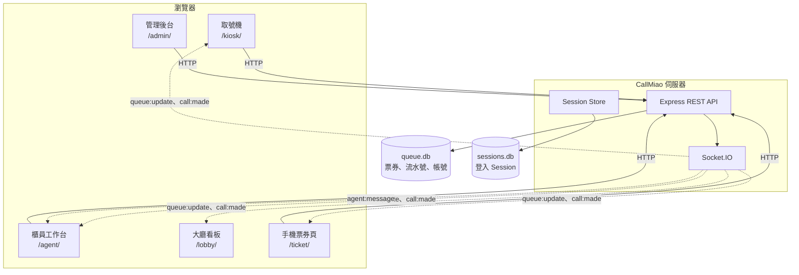
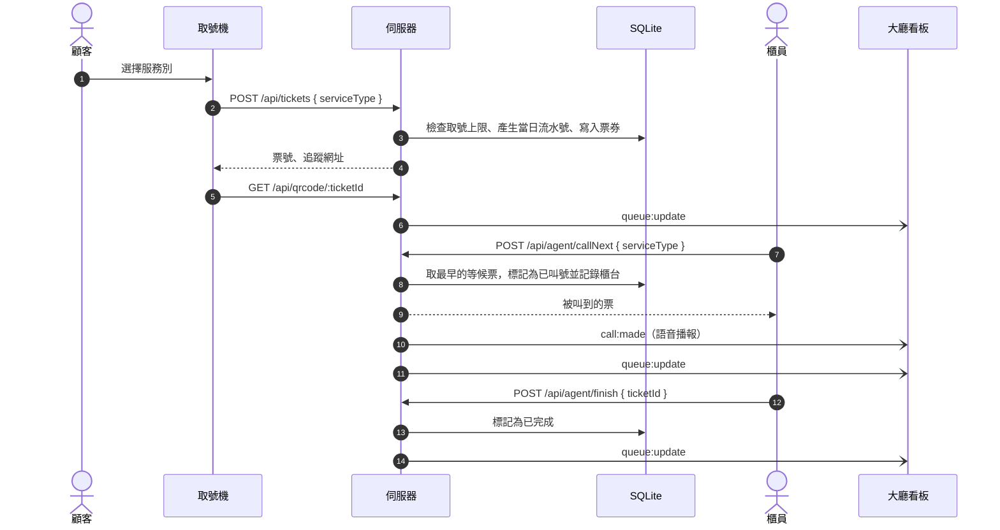
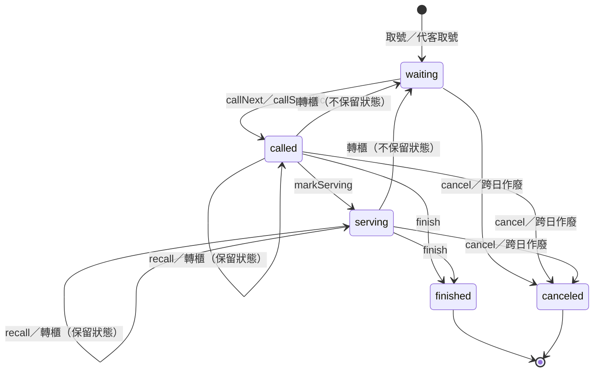
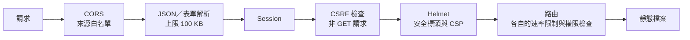

# 系統架構

[← 回到 README](../README.md)

---

## 目錄

- [元件總覽](#元件總覽)
- [取號到完成的流程](#取號到完成的流程)
- [票券生命週期](#票券生命週期)
- [每日編號與跨日作廢](#每日編號與跨日作廢)
- [請求處理順序](#請求處理順序)
- [資料庫結構](#資料庫結構)
- [執行環境與 SQLite 驅動](#執行環境與-sqlite-驅動)
- [目錄結構](#目錄結構)

---

## 元件總覽

叫號喵是單一行程的 Node.js／Bun 應用程式：Express 提供 API 與靜態頁面，Socket.IO 負責即時推播，資料存在本機的 SQLite。前端是不需建置的原生 HTML／JavaScript。



---

## 取號到完成的流程



---

## 票券生命週期



| 狀態 | 意思 |
|------|------|
| `waiting` | 等候中 |
| `called` | 已叫號，記錄叫號的櫃台 |
| `serving` | 服務中 |
| `finished` | 已完成，不能再變更 |
| `canceled` | 已取消，不能再變更；跨日作廢的票 `result` 為 `expired` |

已叫號或服務中的票屬於叫號的櫃台，只有該櫃台與管理員能操作。每個動作允許的狀態見 [API 參考](api.md#票券操作規則)。

---

## 每日編號與跨日作廢

- **編號**：`seq` 資料表依「服務別＋日期」記錄目前發到幾號，票號是代碼加三位數流水號（`A001`）。日期以 `TZ` 設定的時區計算，每天從 1 重新開始。
- **作廢**：每天第一次讀寫佇列時（取號、叫號、查總覽），會把當天零點以前建立、還沒結束的票（等候、已叫號、服務中）全部改為 `canceled`，`result` 設為 `expired`。
- 因為兩者都以 `TZ` 的午夜為準，伺服器主機本身用 UTC 或其他時區也不受影響。

---

## 請求處理順序

每個 HTTP 請求依序通過以下中介層：



- **CORS**：來源不在白名單時直接回 `403`，後面的處理都不會執行。
- **CSRF**：`POST /api/login` 與 `POST /api/tickets` 以外的寫入請求，都要登入並帶有效的 `x-csrf-token`。
- **Helmet**：`/kiosk/` 的 `frame-ancestors` 允許 `ALLOWED_ORIGINS`，其他頁面只允許同源嵌入。

Socket.IO 連線共用同一個 Session 中介層，並在握手時用相同規則檢查 `Origin`。

---

## 資料庫結構

兩個 SQLite 檔案都放在 `DB_DIR`，啟動時自動建立，並開啟 WAL 模式。

### `queue.db`

#### `tickets`：票券

| 欄位 | 型態 | 說明 |
|------|------|------|
| `id` | INTEGER PK | 自動遞增的票券 ID |
| `serviceType` | TEXT | 服務代碼 |
| `number` | TEXT | 票號，例如 `A001` |
| `status` | TEXT | `waiting`、`called`、`serving`、`finished`、`canceled` |
| `counter` | TEXT | 叫號的櫃台號 |
| `result` | TEXT | 完成備註或取消原因；跨日作廢為 `expired` |
| `createdAt` | TEXT | 取號時間（ISO 8601） |
| `calledAt` | TEXT | 最近一次叫號時間 |
| `finishedAt` | TEXT | 完成或取消時間 |
| `clientKey` | TEXT | 匿名取號來源 IP 的 HMAC；代客取號與 `KIOSK_IPS` 為空值 |

索引：`(status, serviceType, createdAt)`、`(counter, status)`、`(clientKey, status)`。

#### `seq`：每日流水號

| 欄位 | 型態 | 說明 |
|------|------|------|
| `serviceType` | TEXT PK | 服務代碼 |
| `ymd` | TEXT PK | 日期，`YYYYMMDD` |
| `seq` | INTEGER | 當天已發出的最大號碼 |

#### `agents`：櫃員與管理員帳號

| 欄位 | 型態 | 說明 |
|------|------|------|
| `id` | INTEGER PK | 帳號 ID |
| `account` | TEXT UNIQUE | 登入帳號 |
| `name` | TEXT | 顯示名稱，不可與他人重複；空值時以帳號顯示 |
| `password` | TEXT | bcrypt 雜湊 |
| `counter` | TEXT | 指派的櫃台號 |
| `role` | TEXT | `admin` 為管理員，其他為一般櫃員 |
| `active` | INTEGER | `1` 啟用，`0` 停用 |
| `sessionVersion` | INTEGER | 改密碼或停用時遞增，讓既有 Session 失效 |
| `createdAt` | TEXT | 建立時間 |
| `updatedAt` | TEXT | 最後更新時間 |

### `sessions.db`

#### `sessions`：登入 Session

| 欄位 | 說明 |
|------|------|
| `sid` | Session ID |
| `expired` | 到期時間（毫秒時間戳） |
| `sess` | Session 內容（JSON） |

Session 有效 8 小時，過期資料每 15 分鐘清理一次。資料表格式與 `connect-sqlite3` 相同，舊版的 `sessions.db` 可以直接沿用。

---

## 執行環境與 SQLite 驅動

[`lib/sqlite.js`](../lib/sqlite.js) 依執行環境選擇驅動，對外提供相同的介面：

| 執行環境 | 驅動 | 備註 |
|----------|------|------|
| Bun | 內建 `bun:sqlite` | Bun 無法載入 `better-sqlite3` 原生模組 |
| Node.js 22+ | `better-sqlite3` | 選用相依；安裝時會下載預先編譯的版本，沒有對應版本時才需要 C++ 編譯工具 |

Session Store（[`lib/session-store.js`](../lib/session-store.js)）建立在同一個驅動上，所以兩種執行環境都不需要額外的原生模組。

---

## 目錄結構

```text
CallMiao/
├── server.js                  # 伺服器入口：設定檢查、API、Socket.IO、安全中介層
├── lib/
│   ├── sqlite.js              # 依執行環境選用 bun:sqlite 或 better-sqlite3
│   └── session-store.js       # express-session 的 SQLite Store
├── public/                    # 前端靜態頁面（每個資料夾都有 index.js 與 style.css）
│   ├── kiosk/                 # 取號機；widget.js 供其他網站嵌入
│   ├── agent/                 # 櫃員工作台
│   ├── lobby/                 # 大廳看板與語音播報
│   ├── ticket/                # 手機票券頁
│   ├── login/                 # 登入頁（含驗證碼）
│   └── admin/                 # 管理後台（agents.html）
├── test/
│   └── server.test.js         # 整合測試（bun test）
├── docs/                      # 設定、API、架構與部署文件
├── .env.example               # 環境變數範本
├── CHANGELOG.md               # 更新紀錄
├── SECURITY.md                # 安全性說明與漏洞回報
└── LICENSE                    # MIT 授權
```

`DB_DIR` 指定的資料庫目錄與 `.env` 都不會進入版本控制。
