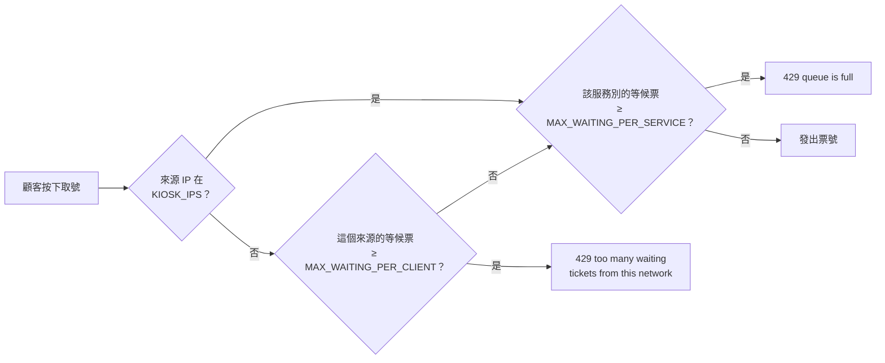

# 環境變數設定

[← 回到 README](../README.md)

叫號喵的所有設定都放在專案根目錄的 `.env`。從 `.env.example` 複製一份開始改：

```bash
cp .env.example .env
```

伺服器啟動時會逐項檢查；必填的變數缺少或格式不對，就會在終端機印出 `CRITICAL` 訊息並停止啟動。

---

## 目錄

- [設定範本](#設定範本)
- [變數總表](#變數總表)
- [服務別設定](#服務別設定)
- [取號上限怎麼設](#取號上限怎麼設)
- [來源白名單規則](#來源白名單規則)
- [反向代理設定](#反向代理設定)

---

## 設定範本

### 開發環境

```env
NODE_ENV=development
TZ=Asia/Taipei
SESSION_SECRET=請換成-32-字元以上的隨機字串
DB_DIR=db

SERVICE_TYPES=A,B,C
SERVICE_NAME_A=一般服務
SERVICE_DESC_A=申請、異動與諮詢
SERVICE_NAME_B=繳費服務
SERVICE_DESC_B=繳費與還款
SERVICE_NAME_C=諮詢服務
SERVICE_DESC_C=商品與方案諮詢

MAX_WAITING_PER_SERVICE=200
MAX_WAITING_PER_CLIENT=3
KIOSK_IPS=
```

開發模式會自動允許 `http://localhost:PORT`，以及與伺服器同主機的來源（例如用 `bun start --host` 時的區網 IP）。

### 正式環境

```env
NODE_ENV=production
TZ=Asia/Taipei
SESSION_SECRET=<用下方指令產生>
DB_DIR=/var/lib/callmiao

SERVICE_TYPES=A,B,C
SERVICE_NAME_A=一般服務
SERVICE_DESC_A=申請、異動與諮詢
SERVICE_NAME_B=繳費服務
SERVICE_DESC_B=繳費與還款
SERVICE_NAME_C=諮詢服務
SERVICE_DESC_C=商品與方案諮詢

MAX_WAITING_PER_SERVICE=200
MAX_WAITING_PER_CLIENT=3
KIOSK_IPS=203.0.113.10

PUBLIC_ORIGIN=https://queue.example.com
ALLOWED_ORIGINS=https://www.example.com
TRUST_PROXY=1
```

產生 `SESSION_SECRET`：

```bash
bun -e "console.log(require('crypto').randomBytes(32).toString('base64'))"
```

---

## 變數總表

### 基本設定

| 變數 | 必填 | 說明 |
|------|:----:|------|
| `NODE_ENV` | 選填 | 設為 `production` 時啟用正式模式；其他值或未設定都視為開發模式 |
| `PORT` | 選填 | HTTP 監聽埠，未設定時用 `3000` |
| `TZ` | 是 | 營業時區，IANA 名稱，例如 `Asia/Taipei`。票號每天重新編號、前一天的票自動作廢，都以這個時區的午夜為準；名稱無效時拒絕啟動 |
| `SESSION_SECRET` | 是 | Session 簽章金鑰，也用來雜湊取號來源 IP；建議 32 字元以上的隨機字串 |
| `DB_DIR` | 是 | 放 `queue.db` 與 `sessions.db` 的目錄，可用相對專案根目錄的路徑（例如 `db`）或絕對路徑；不存在時自動建立 |

### 服務別

| 變數 | 必填 | 說明 |
|------|:----:|------|
| `SERVICE_TYPES` | 是 | 逗號分隔的服務代碼，只能用英文字母與數字，例如 `A,B,C`。小寫會自動轉成大寫 |
| `SERVICE_NAME_<代碼>` | 是 | 該服務的顯示名稱，每個代碼都要有 |
| `SERVICE_DESC_<代碼>` | 是 | 該服務的說明文字，每個代碼都要有 |

### 佇列上限

| 變數 | 必填 | 說明 |
|------|:----:|------|
| `MAX_WAITING_PER_SERVICE` | 是 | 每個服務別最多幾張等候中的票，正整數。額滿時匿名取號回 `429`，櫃員代客取號不受限制 |
| `MAX_WAITING_PER_CLIENT` | 是 | 同一個來源網路最多同時持有幾張等候中的票，正整數 |
| `KIOSK_IPS` | 是（可留空） | 不受 `MAX_WAITING_PER_CLIENT` 限制的 IP，逗號分隔。變數本身一定要存在，值可以是空的 |

### 正式環境

`NODE_ENV=production` 時以下三個都必填。

| 變數 | 說明 |
|------|------|
| `PUBLIC_ORIGIN` | 對外的網址，例如 `https://queue.example.com`。票券連結與 QR Code 用這個網址產生；開發模式未設定時，改用請求的 Host 推算 |
| `ALLOWED_ORIGINS` | 允許跨站呼叫 API、以及可以用 iframe 嵌入取號頁的網站，逗號分隔，結尾不要加 `/` |
| `TRUST_PROXY` | 信任哪些反向代理，見[反向代理設定](#反向代理設定) |

---

## 服務別設定

服務別決定取號機上的卡片、櫃員工作台的服務清單與轉櫃選項。每個代碼要有一組名稱與說明，鍵名結尾必須與代碼完全相同：

```env
SERVICE_TYPES=A,B
SERVICE_NAME_A=一般服務
SERVICE_DESC_A=申請、異動與諮詢
SERVICE_NAME_B=繳費服務
SERVICE_DESC_B=繳費與還款
```

票號由代碼加三位流水號組成，例如 `A001`、`B012`，每個服務別每天從 1 重新開始。

> [!WARNING]
> 從 `SERVICE_TYPES` 移除某個代碼後，那個服務別尚未處理的票不會再出現在總覽與看板上，也無法再依序叫號，要到隔天才會自動作廢。調整前請先把該服務別的票處理完。

---

## 取號上限怎麼設

匿名取號（取號機或嵌入的網頁）同時受兩個上限限制：



- **`MAX_WAITING_PER_SERVICE`**：一個服務別最多能排多長。設成現場一天內實際處理得完的量。
- **`MAX_WAITING_PER_CLIENT`**：防止單一來源把佇列塞滿。IPv4 以單一位址計算，IPv6 以同一個 `/56` 網段計算，換 IPv6 位址也繞不過去。
- **共用對外 IP**：店內 Wi-Fi、電信 CGNAT 背後的客人會共用同一個上限，請依「同一個 IP 背後最多幾位客人同時排隊」來設定。
- **`KIOSK_IPS`**：實體取號機、或雲端部署時分行 Wi-Fi 的對外 IP 填在這裡，就不受來源上限限制。在反向代理後方時，請填經 `TRUST_PROXY` 解析後的來源 IP。

來源 IP 會以 `SESSION_SECRET` 做 HMAC 後才存進資料庫，不保存原始 IP。櫃員從工作台代客取號不受這兩個上限限制。

---

## 來源白名單規則

瀏覽器發出的請求會帶 `Origin` 標頭，伺服器依下表決定是否放行。HTTP 請求與 Socket.IO 連線用同一套規則。

| 請求來源 | 開發模式 | 正式模式 |
|----------|:--------:|:--------:|
| 沒有 `Origin`（同源 GET、curl、伺服器端程式） | 允許 | 允許 |
| 與伺服器同主機（`Origin` 的主機等於請求的 `Host`） | 允許 | 允許 |
| `http://localhost:<PORT>` | 允許（自動加入） | 依同主機規則 |
| 列在 `ALLOWED_ORIGINS` 或等於 `PUBLIC_ORIGIN` | 允許 | 允許 |
| 本機其他連接埠（`http://localhost:5173`、`127.0.0.1` 等） | 需列入 `ALLOWED_ORIGINS` | 需列入 `ALLOWED_ORIGINS` |
| 其他網站 | 拒絕（`403`） | 拒絕（`403`） |

被拒絕的請求會回 `403 { "error": "origin not allowed" }`，並在伺服器記錄 `CORS blocked` 日誌。

> [!NOTE]
> 本機其他連接埠必須明確列入，是因為 Session Cookie 會在同一主機的所有連接埠之間共用。

---

## 反向代理設定

`TRUST_PROXY` 決定伺服器相信哪些代理傳來的 `X-Forwarded-*` 標頭。這會影響速率限制與取號上限看到的來源 IP，也會影響開發模式下推算的公開網址。

| 值 | 適用情況 |
|----|----------|
| `1` | 前面有一層 Nginx 或其他反向代理 |
| `2`、`3`… | 前面有多層代理（例如 CDN 加 Nginx） |
| `loopback` | 只信任同一台電腦上的代理，例如 VS Code Dev Tunnels、ngrok 等通道；區網裝置直接連線時不受影響 |
| `false` | 沒有代理，客戶端直接連到伺服器 |
| `127.0.0.1,10.0.0.0/8` | 只信任這些 IP 或網段的代理 |

> [!CAUTION]
> 設得比實際代理層數多，客戶端就能偽造 `X-Forwarded-For` 來繞過速率限制與取號上限。
